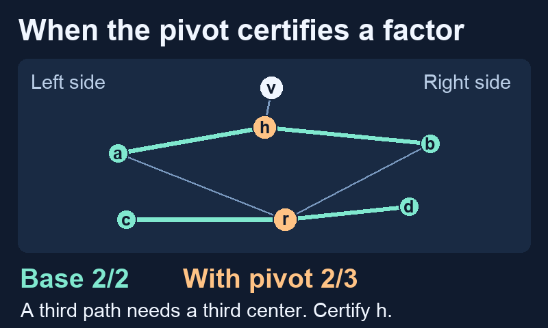

# Recognizing M-identifiability of factor graphs

   

Recognizing ordinary M-identifiability of a factor analysis graph is NP-complete when matching witnesses have unrestricted size. This answers the ordinary half of Conjecture 5.3 of Sturma, Kranzlmueller, Portakal and Drton.

[Read the paper](paper/manuscript.pdf) · [LaTeX source](paper/manuscript.tex) · [Original conjecture](https://arxiv.org/html/2502.02986v2#S5) · [Catalog Q403](https://github.com/10m-u/open-problems-catalog/blob/ca8d4d44ba3db527f19f28928c240168f545ecfe/problems/mathematics/mathematical-statistics.md#q403) · [Version DOI](https://doi.org/10.5281/zenodo.24570842)

## Explore the proof in 3D

The base sides have two matching paths through h and r. Add the observation v to both sides. A full match now needs three distinct centers, so v certifies its sole parent h. Toggle the additional factor s in the explorer to see all three paths become available and the certification fail.

[Download the offline explorer](https://raw.githubusercontent.com/DannyExperiments/recognizing-m-identifiability/v1.0.0/visualization/matching-pivot-explorer.zip) · [Explorer source](visualization/index.html) · [GIF rendering source](visualization/render.py)

## Why the proof works

If a base matching exists but loses its full size when h is deleted, a minimum cut selects smaller sides whose matching uses every common parent. In the constructed graph each common relay or lock must then use its available endpoints. This forces the variable colors and lets the first pivot certify a factor exactly when the input clauses can be satisfied. On a satisfying input, the same witness gives a full sequence. An additional search over three labels per factor gives an exact O*(3^m)-time algorithm when there are m latent factors.

## Reproduce the checks

    python3 -I scripts/verify_repository.py
    python3 -I verification/src/replay.py

The [recorded replay](verification/results/replay.txt) checks three full certification sequences, 4,096 small matching networks, 256 whole-graph comparisons, and the worked graph. The [paper](paper/manuscript.pdf) proves the general results. See [scope](CLAIM_SCOPE_AND_LIMITATIONS.md), [reproducibility](REPRODUCIBILITY.md) and the [research disclosure](AI_DISCLOSURE.md).

## Cite

DannyExperiments. *Recognizing M-identifiability of factor graphs*. Version 1.0.0, 27 November 2026. [Version DOI](https://doi.org/10.5281/zenodo.24570842).
